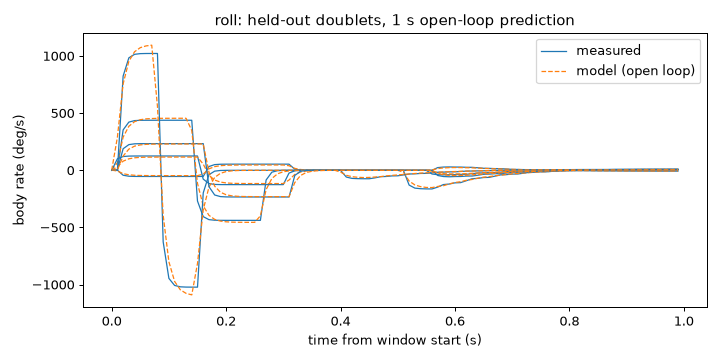
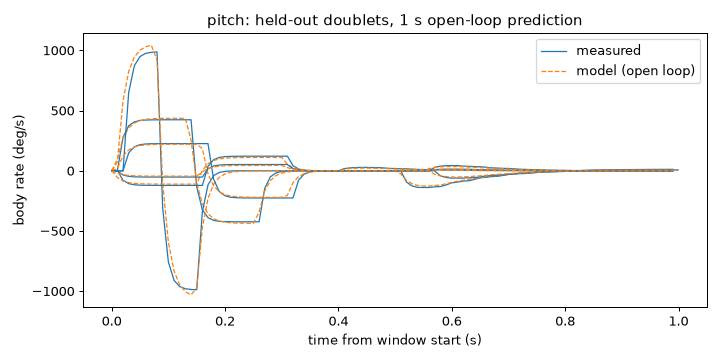
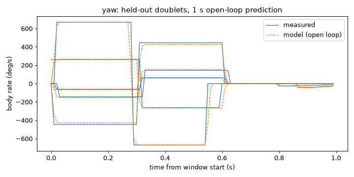
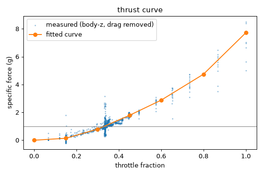
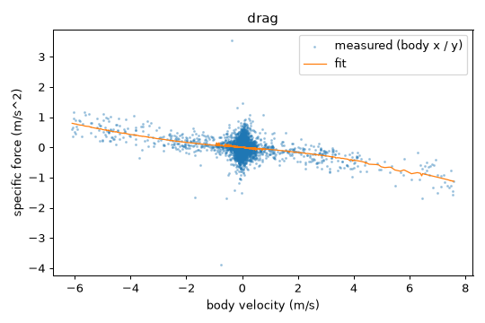
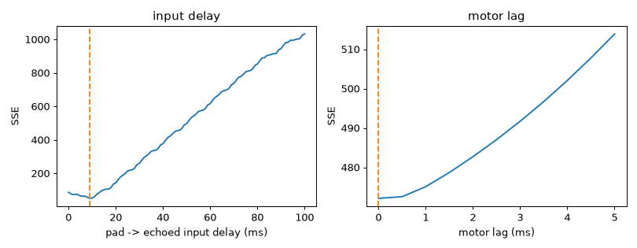

# System identification: Liftoff Vortex Pro 250 (stock 5-inch) (`liftoff-5inch-vortex-pro-250`)

- Session: `vortex-full` (2026-10-12T16:23:50Z), plant: liftoff, seed 0
- Liftoff drone: Vortex Pro 250; map: Liftoff Arena (free flight, no track)
- Settings: preset `liftoff`; schedule 93 experiments in 3 passes (last pass held out)
- Git: `337ffcac103069cbd0b50765d06788307a9df58c`

**fit_quality: poor.** AC8 NOT MET: held-out 1 s open-loop error 4.2 % of the commanded rate (limit 15 %) and 0.153 g vertical (limit 0.15 g); the profile is written with fit_quality: poor.

## Fitted values

| parameter | value | sigma | fit residual |
|---|---|---|---|
| latency.input_s | 0.009 | 1.181e-05 | 0.0236 |
| rates.roll.rc_rate | 0.9713 | 0.04051 | 1.655 |
| rates.roll.super_rate | 0.8233 | 0.009019 | 1.655 |
| rates.roll.expo | 0 | - | 1.655 |
| rates.roll.tau_s | 0.01168 | 0.0007694 | 1.655 |
| rates.roll.delay_s | 0.003439 | 0.0004225 | 1.655 |
| rates.pitch.rc_rate | 0.929 | 0.03387 | 1.369 |
| rates.pitch.super_rate | 0.8241 | 0.007747 | 1.369 |
| rates.pitch.expo | 0 | - | 1.369 |
| rates.pitch.tau_s | 0.01379 | 0.0008582 | 1.369 |
| rates.pitch.delay_s | 4.711e-16 | 0.0005827 | 1.369 |
| rates.yaw.rc_rate | 1.484 | 0.02838 | 0.8734 |
| rates.yaw.super_rate | 0.5557 | 0.01005 | 0.8734 |
| rates.yaw.expo | 0 | - | 0.8734 |
| rates.yaw.tau_s | 0.004 | 0.0003143 | 0.8734 |
| rates.yaw.delay_s | 0.001085 | 0.0001539 | 0.8734 |
| drag.linear_per_s | 0.05814 | 0.002595 | 0.02421 |
| drag.quadratic_per_m | 0.01186 | 0.0005078 | 0.02421 |
| motor_lag_s | 0 | - | 0.1464 |
| hover_throttle | 0.3311 | 0.0009207 | 0.1464 |
| latency.control_to_gyro_s | 0.01051 | 0.0003866 | 0.001436 |

Residuals: rates in rad/s (output error), thrust in g, drag in g, delays as RMS of the echo error (stick units). Units: throttle fraction 0..1 (stick = 2f - 1), rates Betaflight (rc_rate 1.0 = 100), seconds.

### Thrust curve (throttle fraction -> body-z specific force, g)

| throttle | 0 | 0.15 | 0.3 | 0.45 | 0.6 | 0.8 | 1 |
|---|---|---|---|---|---|---|---|
| accel (g) | 0 | 0.141 | 0.795 | 1.78 | 2.88 | 4.74 | 7.72 |
| sigma | 0 | 0.0033 | 0.0023 | 0.0056 | 0.015 | 0.022 | 0.023 |

## Held-out validation (last pass)

| signal | one-step error | 1 s open-loop error | windows |
|---|---|---|---|
| roll rate (% of commanded) | 0.363 % | 0.794 % | 5 |
| pitch rate (% of commanded) | 0.663 % | 1.06 % | 5 |
| yaw rate (% of commanded) | 3.86 % | 4.21 % | 5 |
| vertical accel (g) | 0.147 | 0.153 | 13 |

Limits (AC8): median 1 s open-loop rate error <= 15 % of the commanded rate amplitude, vertical acceleration <= 0.15 g. AC8 NOT MET: held-out 1 s open-loop error 4.2 % of the commanded rate (limit 15 %) and 0.153 g vertical (limit 0.15 g); the profile is written with fit_quality: poor.

## Hover

- From the thrust curve: throttle 0.3311 (stick -0.3379); settled hover throttle 0.3337 (5960 samples), difference -0.0026

## Airframe check (ground-ramp hover vs. the expected band)

- ok: h0 0.2988, band [0.1, 0.4], source ui_driver.DRONE_SLOTS['Vortex Pro 250']
- ok: h0 0.298, band [0.1, 0.4], source ui_driver.DRONE_SLOTS['Vortex Pro 250']
- ok: h0 0.298, band [0.1, 0.4], source ui_driver.DRONE_SLOTS['Vortex Pro 250']

## Battery

- Voltage 21.01 V -> 19.30 V (min 17.53 V); the level is reset (full battery) between passes.
- Thrust sensitivity: -0.1 % thrust per volt (measured / model ratio vs. voltage). Not voltage-parameterised in the profile.

## Violations and aborted experiments

- None.
- Session stop reason: completed

## Default randomization (UC67)

nominal +- max(3 sigma, 10 %), clamped at 0; multipliers 1 +- max(3 sigma_rel, 10 %).

| parameter | min | max |
|---|---|---|
| thrust_scale | 0.9 | 1.1 |
| rates.roll.rate_scale | 0.8749 | 1.125 |
| rates.roll.tau_s | 0.009368 | 0.01398 |
| rates.roll.delay_s | 0.002172 | 0.004707 |
| rates.pitch.rate_scale | 0.8906 | 1.109 |
| rates.pitch.tau_s | 0.01121 | 0.01636 |
| rates.pitch.delay_s | 0 | 0.001748 |
| rates.yaw.rate_scale | 0.9 | 1.1 |
| rates.yaw.tau_s | 0.003057 | 0.004943 |
| rates.yaw.delay_s | 0.0006228 | 0.001546 |
| drag.linear_per_s | 0.05035 | 0.06593 |
| drag.quadratic_per_m | 0.01034 | 0.01339 |
| motor_lag_s | 0 | 0 |
| latency.control_to_gyro_s | 0.009348 | 0.01167 |

## Notes

- roll: expo ill-conditioned (sigma 0.47); fixed at 0, which fits as well
- pitch: expo ill-conditioned (sigma 0.41); fixed at 0, which fits as well
- yaw: expo ill-conditioned (sigma 0.27); fixed at 0, which fits as well

Stick -> body-rate signs measured: roll +1, pitch +1, yaw -1.

## Plots

<!-- uc67-plant-replay:begin -->
## Plant replay (UC67)

Generated by `drone-fly sim replay-sysid` from session `vortex-full`: the held-out windows' logged sticks fed open-loop into the nominal `drone_fly.sim.Plant` (exact integrator, 1 ms steps) from the measured initial state.

**Not gated (fit_quality poor): median 1 s attitude error 0.60 deg, velocity error 0.650 m/s.**

| statistic | 1 s | 2 s | window mean |
|---|---|---|---|
| median attitude error (deg) | 0.599 | 0.242 | 0.471 |
| median velocity error (m/s) | 0.65 | 0.433 | 0.503 |
| windows | 31 | 8 | 31 |

Windows whose experiment span (window + recovery) is shorter than the horizon are left out of that column. Per-window results:

| experiment | kind | span (s) | att 1 s | vel 1 s | att 2 s | vel 2 s | att mean | vel mean |
|---|---|---|---|---|---|---|---|---|
| `p2-coast-15+` | coast | 3.89 | 2.54 | 0.616 | 0.128 | 0.977 | 1.56 | 0.567 |
| `p2-coast-25-` | coast | 3.89 | 1.83 | 0.915 | 0.364 | 1.43 | 1.17 | 0.827 |
| `p2-doublet-roll-0.20-` | rate_doublet | 1.75 | 0.345 | 0.219 | - | - | 0.339 | 0.228 |
| `p2-chirp` | throttle_chirp | 4.49 | 0.269 | 0.289 | 0.268 | 0.344 | 0.263 | 0.248 |
| `p2-doublet-roll-0.80+` | rate_doublet | 1.70 | 1.17 | 0.997 | - | - | 1.2 | 0.883 |
| `p2-doublet-yaw-0.80+` | rate_doublet | 2.04 | 0.894 | 0.238 | 0.493 | 0.288 | 1.59 | 0.208 |
| `p2-doublet-yaw-0.60-` | rate_doublet | 2.04 | 7.52 | 0.484 | 8.22 | 0.523 | 5.73 | 0.445 |
| `p2-doublet-roll-0.40+` | rate_doublet | 1.74 | 0.681 | 0.0443 | - | - | 0.751 | 0.0914 |
| `p2-step-1.00+` | throttle_step | 1.94 | 0.264 | 2.66 | - | - | 0.136 | 1.91 |
| `p2-step-1.00-` | throttle_step | 1.99 | 0.599 | 1.14 | - | - | 0.391 | 0.613 |
| `p2-burst-1.00+` | throttle_burst | 1.40 | 0.282 | 1.75 | - | - | 0.222 | 1.22 |
| `p2-doublet-yaw-1.00-` | rate_doublet | 1.99 | 6.84 | 0.101 | - | - | 5.43 | 0.112 |
| `p2-doublet-pitch-0.80+` | rate_doublet | 1.70 | 1.32 | 0.827 | - | - | 1.03 | 0.766 |
| `p2-burst-0.80+` | throttle_burst | 1.46 | 1.17 | 1.44 | - | - | 0.844 | 1.02 |
| `p2-step-0.80-` | throttle_step | 2.00 | 0.0438 | 1.1 | - | - | 0.121 | 0.61 |
| `p2-doublet-roll-1.00+` | rate_doublet | 1.58 | 1.07 | 0.945 | - | - | 1.39 | 0.923 |
| `p2-step-0.20+` | throttle_step | 1.99 | 0.383 | 0.65 | - | - | 0.313 | 0.417 |
| `p2-coast-35+` | coast | 3.89 | 2.86 | 1.21 | 0.132 | 1.97 | 1.75 | 1.11 |
| `p2-step-0.40+` | throttle_step | 2.00 | 0.0466 | 1.09 | - | - | 0.18 | 0.661 |
| `p2-step-0.60-` | throttle_step | 2.00 | 0.0758 | 0.91 | - | - | 0.0656 | 0.503 |
| `p2-step-0.40-` | throttle_step | 2.00 | 0.161 | 0.448 | - | - | 0.0947 | 0.2 |
| `p2-doublet-pitch-1.00+` | rate_doublet | 1.59 | 9.12 | 2.17 | - | - | 9.37 | 2.16 |
| `p2-doublet-pitch-0.40-` | rate_doublet | 1.74 | 0.693 | 0.11 | - | - | 0.493 | 0.0959 |
| `p2-step-0.60+` | throttle_step | 1.99 | 0.321 | 1.62 | - | - | 0.346 | 1.03 |
| `p2-doublet-roll-0.60+` | rate_doublet | 1.75 | 1.14 | 0.305 | - | - | 1.03 | 0.277 |
| `p2-doublet-yaw-0.40+` | rate_doublet | 2.05 | 0.296 | 0.148 | 0.155 | 0.163 | 0.605 | 0.136 |
| `p2-step-0.80+` | throttle_step | 2.00 | 0.37 | 2.37 | - | - | 0.405 | 1.65 |
| `p2-doublet-pitch-0.60+` | rate_doublet | 1.75 | 0.831 | 0.306 | - | - | 0.471 | 0.269 |
| `p2-doublet-yaw-0.20+` | rate_doublet | 2.04 | 0.265 | 0.164 | 0.215 | 0.302 | 0.413 | 0.151 |
| `p2-step-0.20-` | throttle_step | 1.99 | 0.255 | 0.3 | - | - | 0.137 | 0.146 |
| `p2-doublet-pitch-0.20-` | rate_doublet | 1.74 | 0.201 | 0.335 | - | - | 0.205 | 0.267 |
<!-- uc67-plant-replay:end -->
