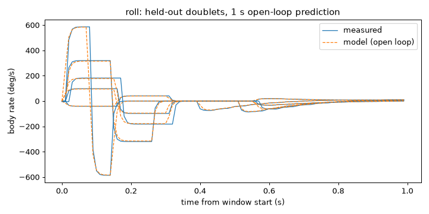
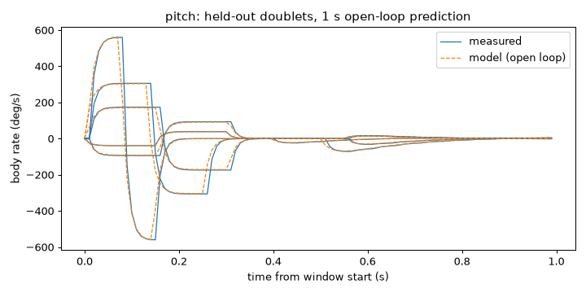
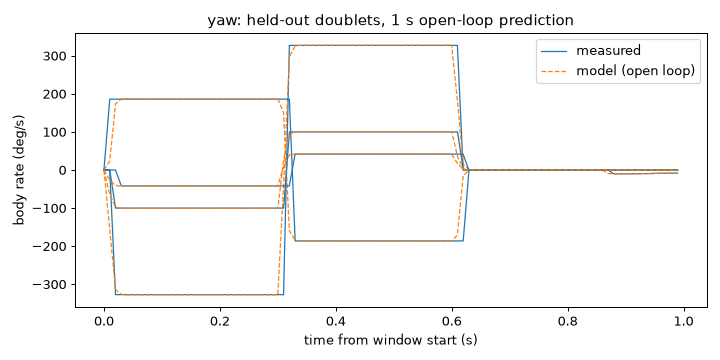
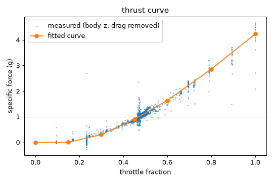
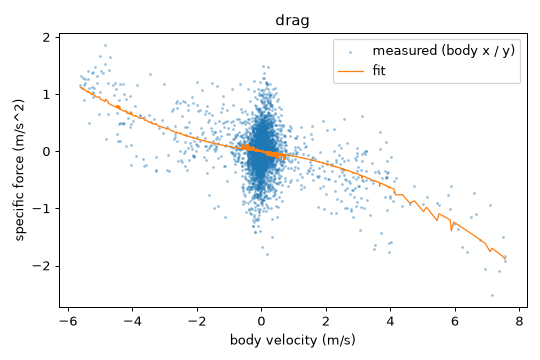
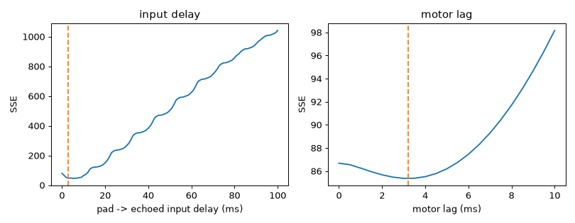

# System identification: Liftoff Test small drone (FT Gremlin micro) (`liftoff-gremlin-micro`)

- Session: `micro-full` (2026-10-12T15:37:55Z), plant: liftoff, seed 0
- Liftoff drone: Test small drone; map: Liftoff Arena (free flight, no track)
- Settings: preset `liftoff`; schedule 93 experiments in 3 passes (last pass held out)
- Git: `67f99c5614c8a9e3bbd93430c75d56fdf1c3cd25`

**fit_quality: good.** AC8 met: held-out 1 s open-loop error 0.6 % of the commanded rate (<= 15 %) and 0.093 g vertical (<= 0.15 g).


## Fitted values

| parameter | value | sigma | fit residual |
|---|---|---|---|
| latency.input_s | 0.003 | 1.212e-05 | 0.02441 |
| rates.roll.rc_rate | 0.8547 | 0.02424 | 0.6978 |
| rates.roll.super_rate | 0.7074 | 0.01056 | 0.6978 |
| rates.roll.expo | 0 | - | 0.6978 |
| rates.roll.tau_s | 0.007101 | 0.0003778 | 0.6978 |
| rates.roll.delay_s | 0.008383 | 0.0001666 | 0.6978 |
| rates.pitch.rc_rate | 0.8191 | 0.0261 | 0.7293 |
| rates.pitch.super_rate | 0.7106 | 0.01203 | 0.7293 |
| rates.pitch.expo | 0 | - | 0.7293 |
| rates.pitch.tau_s | 0.01209 | 0.0007237 | 0.7293 |
| rates.pitch.delay_s | 0.005462 | 0.0004703 | 0.7293 |
| rates.yaw.rc_rate | 0.9084 | 0.01242 | 0.5371 |
| rates.yaw.super_rate | 0.6958 | 0.004797 | 0.5371 |
| rates.yaw.expo | 0 | - | 0.5371 |
| rates.yaw.tau_s | 0.004 | 0.0002424 | 0.5371 |
| rates.yaw.delay_s | 0.006738 | 0.000109 | 0.5371 |
| drag.linear_per_s | 0.0578 | 0.004536 | 0.03503 |
| drag.quadratic_per_m | 0.02509 | 0.0009731 | 0.03503 |
| motor_lag_s | 0.003217 | 0.000142 | 0.06743 |
| hover_throttle | 0.4708 | 0.0007188 | 0.06743 |
| latency.control_to_gyro_s | 0.009861 | 0.0002489 | 0.001196 |

Residuals: rates in rad/s (output error), thrust in g, drag in g, delays as RMS of the echo error (stick units). Units: throttle fraction 0..1 (stick = 2f - 1), rates Betaflight (rc_rate 1.0 = 100), seconds.

### Thrust curve (throttle fraction -> body-z specific force, g)

| throttle | 0 | 0.15 | 0.3 | 0.45 | 0.6 | 0.8 | 1 |
|---|---|---|---|---|---|---|---|
| accel (g) | 0 | 0.001 | 0.303 | 0.898 | 1.63 | 2.85 | 4.23 |
| sigma | 0 | 0.0055 | 0.0043 | 0.00092 | 0.0034 | 0.0054 | 0.0073 |

## Held-out validation (last pass)

| signal | one-step error | 1 s open-loop error | windows |
|---|---|---|---|
| roll rate (% of commanded) | 0.261 % | 0.408 % | 5 |
| pitch rate (% of commanded) | 0.277 % | 0.589 % | 5 |
| yaw rate (% of commanded) | 0.55 % | 0.599 % | 4 |
| vertical accel (g) | 0.0898 | 0.0932 | 13 |

Limits (AC8): median 1 s open-loop rate error <= 15 % of the commanded rate amplitude, vertical acceleration <= 0.15 g. AC8 met: held-out 1 s open-loop error 0.6 % of the commanded rate (<= 15 %) and 0.093 g vertical (<= 0.15 g).

## Hover

- From the thrust curve: throttle 0.4708 (stick -0.0583); settled hover throttle 0.4706 (5697 samples), difference +0.0002
- UC64 comparison: measured hover stick -0.058 vs. UC64's hand-flown -0.06 (throttle 0.470); difference +0.002 stick.

## Airframe check (ground-ramp hover vs. the expected band)

- ok: h0 0.4628, band [0.4, 0.56], source ui_driver.DRONE_SLOTS['Test small drone']
- ok: h0 0.4628, band [0.4, 0.56], source ui_driver.DRONE_SLOTS['Test small drone']
- ok: h0 0.4644, band [0.4, 0.56], source ui_driver.DRONE_SLOTS['Test small drone']

## Battery

- Voltage 12.61 V -> 11.04 V (min 10.08 V); the level is reset (full battery) between passes.
- Thrust sensitivity: +0.3 % thrust per volt (measured / model ratio vs. voltage). Not voltage-parameterised in the profile.

## Violations and aborted experiments

- altitude_ceiling (abort_experiment): altitude 12.98 m in p0-coast-35+
- altitude_ceiling (abort_experiment): altitude 12.29 m in p1-step-0.20+
- altitude_ceiling (abort_experiment): altitude 12.66 m in p2-doublet-yaw-1.00-
- `p0-coast-35+`: aborted:altitude_ceiling
- `p1-step-0.20+`: aborted:altitude_ceiling
- `p2-doublet-yaw-1.00-`: aborted:altitude_ceiling
- Session stop reason: completed

## Default randomization (UC67)

nominal +- max(3 sigma, 10 %), clamped at 0; multipliers 1 +- max(3 sigma_rel, 10 %).

| parameter | min | max |
|---|---|---|
| thrust_scale | 0.9 | 1.1 |
| rates.roll.rate_scale | 0.9 | 1.1 |
| rates.roll.tau_s | 0.005968 | 0.008235 |
| rates.roll.delay_s | 0.007544 | 0.009221 |
| rates.pitch.rate_scale | 0.9 | 1.1 |
| rates.pitch.tau_s | 0.009922 | 0.01426 |
| rates.pitch.delay_s | 0.004051 | 0.006873 |
| rates.yaw.rate_scale | 0.9 | 1.1 |
| rates.yaw.tau_s | 0.003273 | 0.004727 |
| rates.yaw.delay_s | 0.006064 | 0.007412 |
| drag.linear_per_s | 0.04419 | 0.07141 |
| drag.quadratic_per_m | 0.02217 | 0.02801 |
| motor_lag_s | 0.002791 | 0.003643 |
| latency.control_to_gyro_s | 0.008875 | 0.01085 |

## Notes

- roll: expo ill-conditioned (sigma 0.82); fixed at 0, which fits as well
- pitch: expo ill-conditioned (sigma 0.89); fixed at 0, which fits as well
- yaw: expo ill-conditioned (sigma 0.38); fixed at 0, which fits as well

Stick -> body-rate signs measured: roll +1, pitch +1, yaw -1.

## Plots








<!-- uc67-plant-replay:begin -->
## Plant replay (UC67)

Generated by `drone-fly sim replay-sysid` from session `micro-full`: the held-out windows' logged sticks fed open-loop into the nominal `drone_fly.sim.Plant` (exact integrator, 1 ms steps) from the measured initial state.

**AC8 MET: median 1 s attitude error 0.14 deg, velocity error 0.414 m/s (limits <= 10 deg and <= 1 m/s).**

| statistic | 1 s | 2 s | window mean |
|---|---|---|---|
| median attitude error (deg) | 0.141 | 0.0874 | 0.185 |
| median velocity error (m/s) | 0.414 | 0.404 | 0.344 |
| windows | 30 | 8 | 30 |

Windows whose experiment span (window + recovery) is shorter than the horizon are left out of that column. Per-window results:

| experiment | kind | span (s) | att 1 s | vel 1 s | att 2 s | vel 2 s | att mean | vel mean |
|---|---|---|---|---|---|---|---|---|
| `p2-coast-15+` | coast | 3.90 | 0.696 | 0.303 | 0.0194 | 0.441 | 0.42 | 0.32 |
| `p2-coast-25-` | coast | 3.89 | 0.0747 | 0.6 | 0.0116 | 0.907 | 0.087 | 0.542 |
| `p2-doublet-roll-0.20-` | rate_doublet | 1.75 | 0.0462 | 0.402 | - | - | 0.0397 | 0.273 |
| `p2-chirp` | throttle_chirp | 4.50 | 0.134 | 0.2 | 0.132 | 0.219 | 0.132 | 0.18 |
| `p2-doublet-roll-0.80+` | rate_doublet | 1.70 | 0.584 | 0.167 | - | - | 0.621 | 0.235 |
| `p2-doublet-yaw-0.80+` | rate_doublet | 2.05 | 0.106 | 0.475 | 0.142 | 0.366 | 0.245 | 0.39 |
| `p2-doublet-yaw-0.60-` | rate_doublet | 2.05 | 3.78 | 0.415 | 3.82 | 0.126 | 3.69 | 0.284 |
| `p2-doublet-roll-0.40+` | rate_doublet | 1.74 | 0.0364 | 0.309 | - | - | 0.08 | 0.188 |
| `p2-step-1.00+` | throttle_step | 1.99 | 0.277 | 1.12 | - | - | 0.196 | 0.744 |
| `p2-step-1.00-` | throttle_step | 1.99 | 2.13 | 0.96 | - | - | 1.37 | 0.697 |
| `p2-burst-1.00+` | throttle_burst | 1.55 | 0.0476 | 0.873 | - | - | 0.0539 | 0.652 |
| `p2-doublet-pitch-0.80+` | rate_doublet | 1.69 | 0.139 | 0.113 | - | - | 0.244 | 0.141 |
| `p2-burst-0.80+` | throttle_burst | 1.60 | 0.148 | 0.884 | - | - | 0.133 | 0.654 |
| `p2-step-0.80-` | throttle_step | 2.00 | 0.992 | 0.898 | - | - | 0.676 | 0.652 |
| `p2-doublet-roll-1.00+` | rate_doublet | 1.58 | 5.2 | 0.593 | - | - | 4.79 | 0.623 |
| `p2-step-0.20+` | throttle_step | 1.99 | 0.21 | 0.21 | - | - | 0.189 | 0.179 |
| `p2-coast-35+` | coast | 3.89 | 0.142 | 0.734 | 0.0191 | 1.1 | 0.101 | 0.677 |
| `p2-step-0.40+` | throttle_step | 1.99 | 0.0158 | 0.366 | - | - | 0.0328 | 0.224 |
| `p2-step-0.60-` | throttle_step | 1.99 | 0.85 | 0.856 | - | - | 0.715 | 0.577 |
| `p2-step-0.40-` | throttle_step | 2.00 | 0.0376 | 0.41 | - | - | 0.0625 | 0.401 |
| `p2-doublet-pitch-1.00+` | rate_doublet | 1.59 | 0.262 | 0.171 | - | - | 0.291 | 0.218 |
| `p2-doublet-pitch-0.40-` | rate_doublet | 1.75 | 0.275 | 0.356 | - | - | 0.219 | 0.298 |
| `p2-step-0.60+` | throttle_step | 2.00 | 0.111 | 0.715 | - | - | 0.113 | 0.423 |
| `p2-doublet-roll-0.60+` | rate_doublet | 1.75 | 0.0356 | 0.0797 | - | - | 0.313 | 0.222 |
| `p2-doublet-yaw-0.40+` | rate_doublet | 2.05 | 0.118 | 0.412 | 0.189 | 0.186 | 0.0927 | 0.307 |
| `p2-step-0.80+` | throttle_step | 2.00 | 0.218 | 0.982 | - | - | 0.182 | 0.677 |
| `p2-doublet-pitch-0.60+` | rate_doublet | 1.75 | 0.275 | 0.482 | - | - | 0.211 | 0.279 |
| `p2-doublet-yaw-0.20+` | rate_doublet | 2.05 | 0.0435 | 0.375 | 0.0432 | 0.627 | 0.147 | 0.352 |
| `p2-step-0.20-` | throttle_step | 1.99 | 0.0032 | 0.235 | - | - | 0.027 | 0.336 |
| `p2-doublet-pitch-0.20-` | rate_doublet | 1.74 | 0.116 | 0.559 | - | - | 0.114 | 0.509 |
<!-- uc67-plant-replay:end -->

## Power model (UC68)

<!-- uc68-power:start -->
The UC69 live flights on Infinity Loop all ended about 20 s after spin-up, when the 3S pack hit
Liftoff's low-voltage cutoff: 8.10 V, or 2.70 V per cell, at about 74 % charge. The motors then
dropped to idle. The plant's optional power model (`sim/power.py`, the `power` block of
`drone.yaml`, plant config `power: true`) reproduces this.

**Data.** UC66 `micro-full` (148 s, mostly hover, at most 11.7 m/s), plus the 10 UC69 attempts,
which fly near full stick at 20–26 m/s for about 18 s each. Re-run the fit with:

```
python -m drone_fly.sysid.power_fit fit <micro-full telemetry.csv> "<uc69 attempts>/*/telemetry.csv"
```

**Thrust at speed.** The measured specific thrust is the velocity derivative plus gravity,
projected on body up, plus the profile drag. It is about 1.01 g at hover throttle. At full stick it
falls with the axial inflow (the velocity component along body z):
`T_avail = max_g · (V / V_full)^0.05 · max(0.2, 1 − 0.38 · v_axial / 20 m/s)`. RMSE 0.197 g over
3226 full-stick windows.

Voltage has almost no effect on thrust (exponent 0.05). Liftoff's RPM follows the throttle whatever
the pack voltage, until the cutoff.

| speed (m/s) | measured (g) | model (g) |
|---|---|---|
| 0–8 | 3.60 | 3.67 |
| 8–16 | 3.11 | 2.99 |
| 16–22 | 3.14 | 3.05 |
| 22–30 | 2.83 | 2.83 |

At racing speed (24 m/s, v_axial ≈ 17 m/s) full stick gives about 2.8 g, not the profile's 4.23 g.

**Battery.**

*Effort.* The motor effort is `E = max_g · rpm / 33087`. Liftoff's RPM is linear in the zero-inflow
thrust: hover RPM gives 1 g. In the sim, `E = T · inflow^−0.805`, where the exponent is fitted on
RPM at full stick.

*Fitted model* (replayed per session by least squares):

| quantity | model | fitted values |
|---|---|---|
| charge | `dq/dt = −d1 · E^k` | d1 = 0.003887 /s, k = 0.946; hover drains about 0.39 %/s |
| persistent sag | `ds/dt = a · E^p`, with no recovery | a = 1.131e-4 V/s, p = 5.28 |
| voltage | `V = 12.607 − 2.249 · (1 − q) − s − 0.545 · E^0.687` | |

The persistent sag is negligible below an effort of about 2.5 g (0.014 V/s), and about 0.19 V/s at
4 g. The logged voltage stays at 8.08 V at idle after the cutoff, so it does not recover.

*Fit quality.* Voltage RMSE is 0.118 V on UC69 and 0.178 V on micro-full. Charge RMSE is 0.001 on
UC69 and 0.013 on micro-full.

**Validation** (`python -m drone_fly.sysid.power_fit validate`). The logged sticks of each live
attempt are replayed open loop through the full plant (power on, nominal, float64), starting from a
ground start:

| | measured (from spin-up) | replay |
|---|---|---|
| cutoff, all 10 attempts | 20.0–20.3 s | 19.7–19.9 s |
| full-stick thrust per speed band | | within 4 % (table above) |

**Randomization.**

| parameter | range |
|---|---|
| `drain_scale` | 0.9–1.1 |
| `sag_scale` | 0.8–1.2 |
| `inflow_scale` | 0.85–1.15 |
| `initial_charge` | 0.95–1.0 |

**Limits.** The fit covers effort up to 4.23 g and charge between 0.42 and 1. Below 0.42 the
open-circuit voltage is extrapolated linearly. The meteor75 profile has no power block, and every
plant without `power: true` is the UC67 plant.
<!-- uc68-power:end -->
